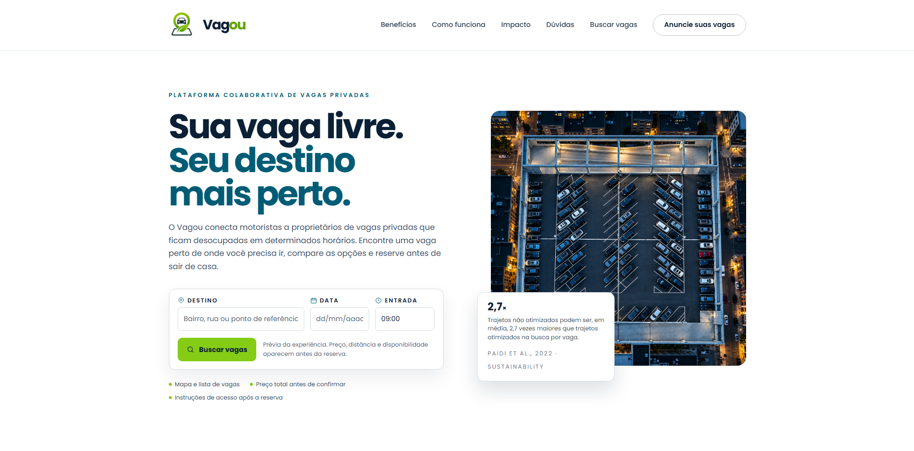

# Vagou

> **Sua vaga livre. Seu destino mais perto.**

O Vagou é uma plataforma colaborativa de vagas privadas. A proposta é conectar motoristas que precisam estacionar perto de um destino a proprietários que têm uma vaga ociosa em determinados horários.



O projeto foi desenvolvido como uma experiência web para o projeto **FIAP Web Design — Global Solution**, com foco em mobilidade urbana, melhor aproveitamento de espaços existentes e uma jornada simples para os dois públicos.

## Problema e proposta

Motoristas frequentemente circulam por várias ruas procurando uma vaga, sem saber previamente quais espaços estão disponíveis, quanto custam ou quais são suas condições de uso. Enquanto isso, garagens residenciais, comerciais e privadas podem permanecer vazias durante parte do dia.

O Vagou propõe aproximar oferta e demanda:

- motoristas pesquisam por destino, data e horário;
- vagas podem ser comparadas por distância, preço, fotos e regras;
- proprietários informam a localização, disponibilidade e condições do espaço;
- a reserva deve apresentar as informações e o preço antes da confirmação.

### Benefícios esperados

- menos tempo procurando estacionamento;
- mais previsibilidade sobre preço, disponibilidade e acesso;
- melhor aproveitamento de vagas privadas ociosas;
- possibilidade de renda adicional para proprietários;
- potencial redução de deslocamentos desnecessários, combustível e emissões.

O conceito está relacionado aos **ODS 11 (Cidades e Comunidades Sustentáveis)**, **ODS 13 (Ação Contra a Mudança Global do Clima)** e **ODS 8 (Trabalho Decente e Crescimento Econômico)**.

## Funcionalidades demonstradas

### Para motoristas

- página inicial com apresentação da solução;
- busca demonstrativa por destino, data e horário;
- página de resultados com mapa ilustrativo e lista de vagas;
- informações de distância, preço, avaliação, cobertura e regras;
- cadastro de usuário com escolha de perfil;
- jornada visual de busca, comparação, reserva e acesso.

### Para proprietários

- página para cadastrar uma vaga;
- campos para endereço, tipo, fotos, preço, disponibilidade e regras;
- definição de horários de funcionamento;
- apresentação da jornada de anúncio, reservas e histórico.

## Estado atual

Este repositório contém um **protótipo navegável de front-end**, sem backend ou banco de dados. As vagas e os resultados exibidos são exemplos estáticos para demonstrar a experiência.

Alguns fluxos futuros que está no nosso radar:

- autenticação e persistência de contas;
- armazenamento e gerenciamento real de anúncios;
- busca dinâmica e geolocalização;
- reservas, checkout e pagamento;
- confirmação de disponibilidade em tempo real;
- histórico de reservas e ganhos.

Os formulários direcionam o usuário para páginas de demonstração ou para `em-desenvolvimento.html` quando a funcionalidade ainda não está implementada.

## Tecnologias

- HTML5 semântico;
- CSS3;
- JavaScript nativo;
- [Bootstrap 5.3.8](https://getbootstrap.com/) via CDN;
- [Bootstrap Icons 1.11.3](https://icons.getbootstrap.com/) via CDN;
- [Google Fonts — Poppins](https://fonts.google.com/specimen/Poppins) via CDN;
- imagens locais em WebP, PNG e JPEG.

Não há processo de build nem dependências locais obrigatórias.

## Como executar

Como o projeto é estático, basta abrir `index.html` em um navegador

## Estrutura do projeto

```text
.
├── index.html                    # Página inicial e apresentação da solução
├── resultados-detalhes.html      # Busca e resultados demonstrativos
├── cadastro.html                 # Cadastro de usuário
├── cadastro-proprietario.html    # Cadastro de vaga
├── em-desenvolvimento.html       # Estado das funcionalidades futuras
├── css/
│   ├── style.css                 # Estilos compartilhados
│   ├── resultados.css            # Página de resultados
│   ├── cadastro.css              # Cadastro de usuário
│   ├── proprietario.css          # Cadastro de vaga
│   └── desenvolvimento.css       # Página de desenvolvimento
├── assets/
│   └── images/                   # Logos, imagens e favicons
```

## Acessibilidade e interface

A interface utiliza HTML semântico, rótulos associados aos campos, textos alternativos em imagens, foco visível, navegação por teclado, link para pular ao conteúdo e menu responsivo. A identidade visual usa a fonte Poppins e uma paleta com azul escuro, verde de destaque e superfícies claras.

## Equipe

Projeto FIAP — Web Design:

- Bruna Zamora — RM 575564
- Caio Tavares — RM 574532
- Isabelli Boaro — RM 576513
- Gabriella Frezza — RM 575895

## Referência conceitual

A apresentação do projeto utiliza como referência o estudo de Paidi et al. (2022), publicado na revista *Sustainability*, sobre o impacto da procura por vagas em deslocamentos, congestionamento e emissões. A apresentação também detalha a proposta de valor, as jornadas dos usuários, as decisões de UX/UI e o alinhamento aos ODS.
